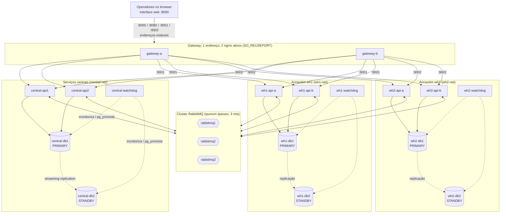

# Arquitetura do OptiWare

## Componentes e redundância (nenhuma camada tem um único componente)

| Camada | Componentes | Réplicas | Como se deteta a falha | Reação |
|---|---|---|---|---|
| **Cliente (interface web)** | `ui/index.html`, servida por `gateway-a` e `gateway-b` na porta 8000 | 2 (os dois nginx) | idem entrada | a página e as chamadas às APIs continuam no mesmo endereço |
| **Entrada** | `gateway-a`, `gateway-b` (nginx) | 2 ativos no mesmo endereço | o kernel deixa de ter o socket de um dos nginx | as ligações novas vão para o outro, no mesmo endereço |
| **Serviço central** | `central-api1/2` | 2 | `max_fails` no nginx | o gateway reencaminha para a outra instância |
| **Serviço de cada armazém** | `whN-api-a/b` | 2 por armazém | `max_fails` no nginx | idem, no mesmo endereço (9001 / 9002) |
| **BD central** | `central-db1/2` + watchdog | primário + standby | watchdog (3 falhas consecutivas) | `pg_promote()` do standby; APIs redescobrem o primário |
| **BD de cada armazém** | `whN-db1/2` + watchdog | primário + standby | idem | idem (por armazém) |
| **Mensagens** | `rabbitmq1/2/3` | cluster de 3 nós | cluster RabbitMQ (Raft) | as quorum queues elegem novo líder; clientes ligam-se a outro nó |

## Responsabilidades

| Componente | Responsabilidade | Dados |
|---|---|---|
| **Armazém** (`warehouse.js`, 2 instâncias sem estado) | produtos, prateleiras, stock, entradas/saídas, encomendas (reserva transacional), CSP, execução das ordens de transferência | BD PostgreSQL **própria** do armazém (primário + standby) |
| **Central** (`central.js`, 2 instâncias sem estado) | autenticação, registo de armazéns (heartbeat), visão global, **coordenação** de transferências | BD PostgreSQL central (primário + standby) |
| **RabbitMQ** | comandos e eventos entre central e armazéns (filas `wh.<id>` e `central.events`) | quorum queues replicadas nos 3 nós |
| **Gateway** | endereço único e estável de cada serviço; failover transparente entre instâncias; serve a interface web | — |
| **Interface web** (`ui/index.html`) | operar a empresa e os armazéns; mostrar o estado de cada contentor (`/stats` de cada instância) | sem estado (só o token da sessão no browser) |
| **Watchdog** (um por par de BD) | deteta falha do primário e promove o standby | — |

## Decisões principais (e justificação)

1. **Endereço estável e failover transparente.** O cliente usa sempre o mesmo endereço (8080 / 9001 / 9002). Se uma instância de backend cai, o nginx reencaminha para a outra sem o cliente mudar de endereço. Os POST repetidos são seguros porque todos têm id idempotente. **9001 e 9002 são armazéns diferentes** (dados diferentes), não réplicas um do outro: a redundância de cada armazém está *dentro* do seu endereço.
2. **Redundância da própria entrada.** `gateway-a` e `gateway-b` partilham o mesmo espaço de rede (o serviço `gateway` só detém o endereço e as portas, como o "pod" do Kubernetes) e ambos escutam as mesmas portas com `reuseport`. O kernel reparte as ligações novas pelos dois; se um nginx cai, todas as ligações novas passam para o outro, sem alterar o endereço. Algumas ligações em curso no nginx que caiu podem falhar e o cliente repete.
3. **Independência dos armazéns.** Cada armazém tem backend e BD próprios, em rede isolada (`whN-net`): não consegue ligar-se à BD de outro armazém nem à do central. O JWT é validado *localmente*, por isso o armazém **não depende do central** para autenticar. Com o central totalmente em baixo, as operações locais continuam.
4. **Transferências por mensagens assíncronas (saga coordenada pelo central).** `REQUESTED → IN_TRANSIT → COMPLETED` (ou `REJECTED`): o central grava o pedido (202), a origem retira o stock e emite `TRANSFER_SHIPPED`, o central envia `TRANSFER_IN` ao destino, que arruma o stock (prateleira escolhida pelo CSP) e emite `TRANSFER_RECEIVED`. Se o destino ou o broker estiverem em baixo, a transferência **fica pendente** e conclui sozinha. Durante o trânsito o stock não existe em nenhum armazém (limitação assumida, visível no estado da transferência).
5. **Sem movimentos duplicados — três camadas.** (a) *Idempotência por id* em encomendas, putaway e transferências; (b) *Inbox*: mensagem já processada é ignorada (`inbox.message_id`); (c) *transições condicionais* no central (`UPDATE … WHERE status = …`).
6. **Consistência de stock por transações.** Reserva com `SELECT … FOR UPDATE` e `CHECK (reserved <= qty)`: pedidos concorrentes nunca vendem mais do que existe.
7. **Transactional outbox + RabbitMQ em cluster.** A mensagem é gravada na mesma transação que os dados e só depois publicada (publisher confirms, mensagens persistentes). As filas são **quorum queues** replicadas pelos 3 nós: uma mensagem confirmada está em maioria (2 de 3) e sobrevive à perda de um nó. **São precisos 3 nós, não 2**: com 2, ao cair um já não há maioria e a fila pára. Os clientes têm a lista dos 3 nós e ligam-se ao seguinte quando um falha. Com `cluster_partition_handling = pause_minority` o lado sem maioria pára, evitando split-brain.
8. **BD com primário + standby em todas as camadas** (central e cada armazém). Streaming replication (assíncrona). O `HAPool` das APIs redescobre o primário (`pg_is_in_recovery()`) e repete a operação. O watchdog promove o standby após 3 falhas consecutivas (~6–8 s). Um nó antigo que volte é automaticamente **re-clonado como standby** (`db/entrypoint-ha.sh`).
9. **IA — CSP** (`csp.js`). Variáveis = lotes a arrumar; domínios = prateleiras; restrições = categoria permitida, zona autorizada, peso e volume máximos cumulativos. Backtracking + MRV + forward checking + best-fit. O sistema **propõe** (`/allocate`) e o operador **confirma** (`/putaway`), que revalida as restrições na transação antes de gravar. Sem solução numa transferência recebida → prateleira `DOCK` (receção).
10. **Visão global tolerante a falhas.** O central guarda um *snapshot* do stock de cada armazém (atualizado a cada 10 s). Se um armazém não responde, mostra o último snapshot marcado `stale`.
11. **Interface web na mesma origem.** A página é estática e é servida pelos dois nginx (porta 8000), que também encaminham `/api/central/`, `/api/wh1/` e `/api/wh2/` para os mesmos upstreams das portas 8080/9001/9002: não é preciso CORS e o cliente herda a redundância da entrada. Cada operação de escrita leva um id criado no browser, por isso a interface pode repetir um pedido sem resposta sem risco de duplicar. O painel de infraestrutura consulta cada instância diretamente (`/node/<instância>/stats`) para mostrar o papel de cada nó de BD, o nó RabbitMQ em uso e as mensagens ainda na outbox.
12. **Segurança (já presente).** JWT com papéis, passwords com scrypt, chave de serviço entre central e armazéns, `audit_log` em todas as BDs. Em falta: TLS e gestão de segredos.

## Pontos únicos de falha remanescentes (assumidos)

| Ponto | Efeito | Mitigação em produção |
|---|---|---|
| **Host Docker único** | se o PC cair, cai tudo (as falhas simulam-se por container) | vários hosts (Swarm/Kubernetes), cada réplica em máquina diferente |
| Contentor `gateway` (dono do endereço) | indisponibilidade de ~2 s até o Docker o reiniciar (`restart: always`); é um processo sem lógica (`sleep`), o nginx redundante está nos outros dois | IP virtual (keepalived/VRRP) ou balanceador cloud |
| Watchdogs (1 por par de BD) | deixa de haver promoção automática; o serviço continua | 2 watchdogs com eleição (Patroni/etcd) |
| Replicação assíncrona das BDs | em falha do primário podem perder-se as últimas transações não replicadas (RPO > 0, janela de ms) | `synchronous_commit` com standby síncrono (custo: disponibilidade de escrita) |
| Arranque total de um par de BD | arrancar primeiro o nó mais atualizado | Patroni |
