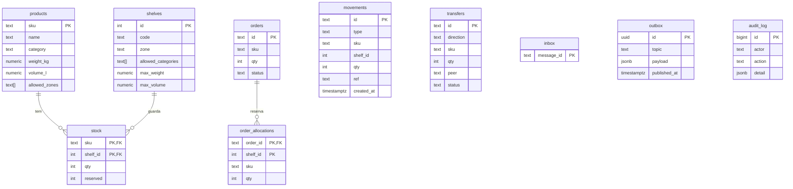
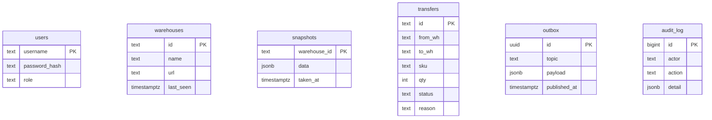

# Estrutura das Bases de Dados (PostgreSQL)

## BD de cada armazém (`optiware_wh`, uma por armazém, com primário `whN-db1` + standby `whN-db2`)

- `movements.id` é a chave de idempotência dos movimentos (impede duplicados).
- `stock`: `CHECK (reserved >= 0 AND reserved <= qty)`.
- `inbox` regista mensagens já processadas; `outbox` guarda mensagens a enviar (transactional outbox).

## BD central (`optiware_central`, primário `central-db1` + standby `central-db2`)

Estados de `transfers.status`: `REQUESTED → IN_TRANSIT → COMPLETED` | `REJECTED`.
